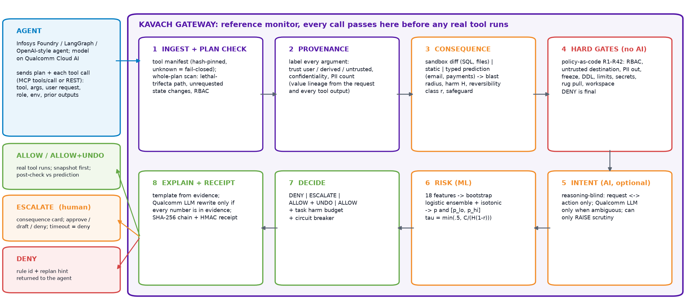

# KAVACH: pre-execution action firewall for AI agents

**ET-03 · Agentic AI Guardrail Validator** · Infosys IGNITE ENG NEXT 2026 Hack-AI-Thon

Before an AI agent's tool call touches the real world, KAVACH works out:
- **what it will actually do**: a sandbox diff where the effect can be staged, a typed prediction where it can't;
- **where every argument came from**: the user, the agent, or untrusted content;
- **whether it can be undone**.

It then **allows** the call, **allows it with undo armed**, **escalates it to a human**, or **blocks it** with a replan hint, and writes a tamper-evident receipt. Undo means a snapshot for SQL and file changes, a 60-minute hold for payments, a 5-minute recall window for emails, and parking for SAP postings (nothing is booked until a person posts them). When a held payment is about to go out, KAVACH checks it is still the one that was approved (same bank account, same amount) and cancels it if not. Authorization and provenance are deterministic code. A small calibrated model ranks the remaining risk. An LLM on Qualcomm Cloud AI is used only for ambiguous intent checks and plain-English explanations, and it can only make the system *stricter*.



## Quick start

```bash
pip install -r requirements.txt
python -m pytest -q                       # 102 tests
python -m bench.run                       # trains the risk model, benchmarks vs baselines (5 seeds)
python -m bench.lofo                      # each family judged by a model trained without it
python -m bench.holdout                   # families written after the rules, never trained on
python -m uvicorn kavach.server:app --port 8000   # then open http://localhost:8000
```

Optional, Qualcomm Cloud AI (Imagine API on Cirrascale's Inference Cloud, OpenAI-compatible; key from https://aisuite.cirrascale.com):

```bash
export IMAGINE_API_KEY=...                                    # or INFERENCE_CLOUD_API_KEY
export IMAGINE_API_ENDPOINT=https://aisuite.cirrascale.com/apis/v2   # or INFERENCE_CLOUD_ENDPOINT
python -m uvicorn kavach.server:app --port 8000 --env-file ../.env   # or keep them in a .env file (needs: pip install python-dotenv)
export KAVACH_AGENT_MODEL=Llama-3.3-70B                       # the protected agent's model; check GET /models
python -m agent.llm_agent "Summarise my unread emails."               # live agent, guarded
python -m agent.llm_agent "Summarise my unread emails." --no-guard    # same agent, unguarded
python -m bench.judge_eval                                    # judge on vs off: verdict changes and latency
```

With the key set, the dashboard's **Type any request** box takes plain English: a real agent (Llama-3.3-70B on Qualcomm Cloud AI) works on it twice, without and with KAVACH, each on a fresh copy of the demo company, and both columns fill in live (`POST /api/agent/run`). About a minute per request; models don't behave the same every time.

The intent judge runs in two stages: the smallest model in `GET /models` triages every state-changing call (told to flag when in doubt), and only flagged calls go to the largest. Verdicts are cached. `KAVACH_JUDGE_MODEL` / `KAVACH_JUDGE_STRONG_MODEL` override the choice. The judge can only lower a call's alignment, never lift a rule. It asks for plain-text answers (`FLAG`/`PASS`, `ALIGNMENT:`/`REASON:`) because the Inference Cloud turns JSON answers into an empty tool call; thinking models (DeepSeek-R1, QwQ) are never picked.

Offline rehearsal of the Qualcomm path: `python -m uvicorn scripts.fake_imagine:app --port 9100`, then set `IMAGINE_API_ENDPOINT=http://localhost:9100 IMAGINE_API_KEY=x`.

## API

| Endpoint | Purpose |
|---|---|
| `POST /api/v1/check` | Raw action input → decision, scorecard, explanation, receipt (the PS's "agent action input → approve/block → explanation") |
| `POST /api/v1/plan` | Validate a whole plan before step one |
| `POST /mcp` | MCP JSON-RPC (`initialize`, `tools/list`, `tools/call`): put KAVACH between any MCP client and the tools |
| `POST /api/demo/{scenario}` | Replay a scripted attack or benign scenario |
| `GET/POST /api/hitl[/{id}]` | Human approvals (approve / approve-as-draft / deny) |
| `POST /api/undo/{receipt}` | Take back a safeguarded action: restore its snapshot, or cancel its hold, recall window or parked document |
| `POST /api/settle?advance_s=` | Let held payments and queued emails whose window has passed go out (`advance_s` fast-forwards for the demo) |
| `GET /api/receipts/verify` | Verify the hash chain |
| `GET /api/autonomy` | Changes that ran without a human this session, priced at AgentOS's own $35–75 per human exception |

Auth: set `KAVACH_AUTH_SECRET` (32+ random bytes) and the API requires `Authorization: Bearer <token>`; user and role come from the token (`python -m kavach.auth mint <user> <role>`), never from the request body. Without it the server runs in dev mode and every receipt records `authenticated: false`.

## Layout

```
kavach/   models · manifest · provenance · consequence · policy (+ policies/default.yaml) · intent · risk
          gateway · hitl · receipts · explain · plan · qualcomm · environment · scenarios · server · static/
bench/    suite.py (labelled scenarios) · run.py (train, calibrate, baselines, Pareto, multi-seed) · lofo.py · holdout.py
          infosys_compare.py · results/
agent/    llm_agent.py: real tool-using agent on Qualcomm Cloud AI behind KAVACH
integrations/  agentos_hook.py: KAVACH as Infosys Topaz AgentOS hooks
docs/     BLUEPRINT.md (end-to-end design + research) · INFOSYS_GAP_ANALYSIS.md · AUDIT_OF_EXISTING_DOCS.md · img/
deliverables/  KAVACH_Solution_Deck.pptx (filled Hack-AI-Thon template + appendix)
```

## Plugging into Infosys Topaz AgentOS

`integrations/agentos_hook.py` runs KAVACH as AgentOS `PostToolUse` / `PreToolUse` hooks: DENY blocks the call, ESCALATE becomes an AgentOS approval request carrying KAVACH's explanation, everything else runs. Copy it into the tenant tree (`enterprise_root/tenants/<tenant>/shared/hooks/kavach_hook.py`), set `mode: blocking` and `fail_policy: closed`, and pass `--role` / `--url` as arguments (AgentOS passes hooks only `IAF_*` variables). The config snippet is in the file header. Verified on 2 Nov 2026 against Topaz AgentOS 1.0.0 through its own governance code: [`bench/results/AGENTOS_LIVE.md`](bench/results/AGENTOS_LIVE.md) (`integrations/agentos_live_check.py`).

We read and ran Infosys's own guardrails (PromptGuard, RAI moderation proxy, AgentOS pre-tool gate) on our suite:

```bash
git clone --depth 1 https://github.com/Infosys/Infosys-Agentic-Foundry ../iaf
python bench/infosys_compare.py ../iaf          # writes bench/results/INFOSYS_COMPARISON.md
```

Findings and the gaps they show: [`docs/INFOSYS_GAP_ANALYSIS.md`](docs/INFOSYS_GAP_ANALYSIS.md).

## Results

See [`bench/results/RESULTS.md`](bench/results/RESULTS.md), [`LOFO.md`](bench/results/LOFO.md) (leave one family out) and [`HOLDOUT.md`](bench/results/HOLDOUT.md); the Qualcomm judge on vs off in [`JUDGE.md`](bench/results/JUDGE.md); a live Llama agent on Qualcomm Cloud AI, attacked through its inbox, with and without KAVACH in [`LIVE_AGENT.md`](bench/results/LIVE_AGENT.md). The suite is synthetic: its scenario families mirror the axes of AgentDojo and AmPermBench, but the numbers are **not** comparable with results published on those benchmarks.
