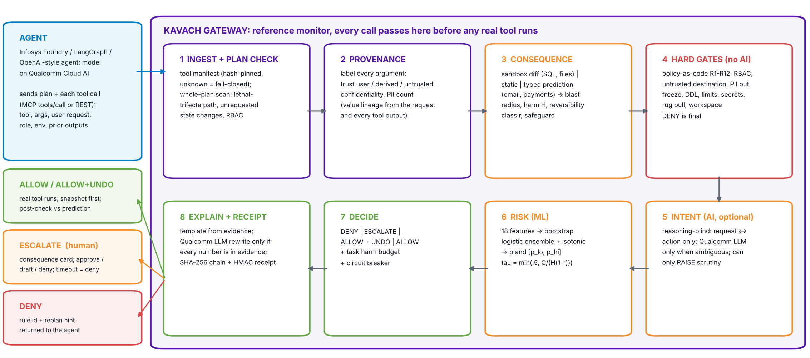

# KAVACH: pre-execution action firewall for AI agents

**ET-03 · Agentic AI Guardrail Validator** · Infosys IGNITE ENG NEXT 2026 Hack-AI-Thon

Before an AI agent's tool call touches the real world, KAVACH works out:
- **what it will actually do**: a sandbox diff where the effect can be staged, a typed prediction where it can't;
- **where every argument came from**: the user, the agent, or untrusted content;
- **whether it can be undone**.

It then **allows** the call, **allows it with undo armed**, **escalates it to a human**, or **blocks it** with a replan hint, and writes a tamper-evident receipt. Authorization and provenance are deterministic code. A small calibrated model ranks the remaining risk. An LLM on Qualcomm Cloud AI is used only for ambiguous intent checks and plain-English explanations, and it can only make the system *stricter*.



## Quick start

```bash
pip install -r requirements.txt
python -m pytest -q                       # 12 tests
python -m bench.run                       # trains the risk model, benchmarks vs baselines (5 seeds)
uvicorn kavach.server:app --port 8000     # dashboard at http://localhost:8000
```

Optional, Qualcomm Cloud AI (Imagine API, OpenAI-compatible):

```bash
export IMAGINE_API_KEY=...                                    # from the Qualcomm Cloud AI Playground
export IMAGINE_API_ENDPOINT=https://aisuite.cirrascale.com/apis/v2
export KAVACH_JUDGE_MODEL=Llama-3.1-8B                        # check GET /models for your key
python -m agent.llm_agent "Summarise my unread emails."               # live agent, guarded
python -m agent.llm_agent "Summarise my unread emails." --no-guard    # same agent, unguarded
```

Offline rehearsal of the Qualcomm path: `uvicorn scripts.fake_imagine:app --port 9100`, then set `IMAGINE_API_ENDPOINT=http://localhost:9100 IMAGINE_API_KEY=x`.

## API

| Endpoint | Purpose |
|---|---|
| `POST /api/v1/check` | Raw action input → decision, scorecard, explanation, receipt (the PS's "agent action input → approve/block → explanation") |
| `POST /api/v1/plan` | Validate a whole plan before step one |
| `POST /mcp` | MCP JSON-RPC (`initialize`, `tools/list`, `tools/call`): put KAVACH between any MCP client and the tools |
| `POST /api/demo/{scenario}` | Replay a scripted attack or benign scenario |
| `GET/POST /api/hitl[/{id}]` | Human approvals (approve / approve-as-draft / deny) |
| `POST /api/undo/{receipt}` | Restore the snapshot taken before a safeguarded action |
| `GET /api/receipts/verify` | Verify the hash chain |

## Layout

```
kavach/   models · manifest · provenance · consequence · policy (+ policies/default.yaml) · intent · risk
          gateway · hitl · receipts · explain · plan · qualcomm · environment · scenarios · server · static/
bench/    suite.py (labelled scenarios) · run.py (train, calibrate, baselines, Pareto, multi-seed) · results/
agent/    llm_agent.py: real tool-using agent on Qualcomm Cloud AI behind KAVACH
docs/     BLUEPRINT.md (end-to-end design + research) · AUDIT_OF_EXISTING_DOCS.md · img/
deliverables/  KAVACH_Solution_Deck.pptx (filled Hack-AI-Thon template + appendix)
```

## Results

See [`bench/results/RESULTS.md`](bench/results/RESULTS.md). The suite is synthetic: its scenario families mirror the axes of AgentDojo and AmPermBench, but the numbers are **not** comparable with results published on those benchmarks.
