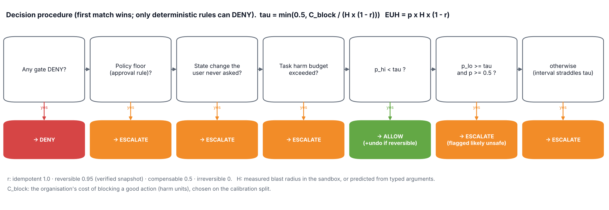

# KAVACH: pre-execution action firewall for AI agents
### ET-03 Agentic AI Guardrail Validator · Infosys IGNITE ENG NEXT 2026 · end-to-end blueprint

> **One line:** before an AI agent's action touches the real world, KAVACH works out what the action will *actually do* (sandbox diff where possible, a typed prediction where not) and *where every argument came from*. It then decides, with calibrated confidence, whether to allow it, allow it with undo armed, ask a human, or block it, and writes a tamper-evident receipt explaining why. **The LLM never makes the decision.**

Naming: *Kavach* (कवच, "armour") is also the name of Indian Railways' automatic train-protection system. That system brakes a train **before** a collision when the driver misses a signal. KAVACH does the same for agents.

---

## 0. Status: what exists today vs. what is planned

| Works now (in `kavach/`, tested) | Planned / roadmap |
|---|---|
| Gateway: 12 deterministic policy rules, provenance/taint by value lineage, plan validator | Full MCP streamable-HTTP transport (via FastMCP); today: MCP JSON-RPC `tools/list` + `tools/call` |
| Consequence engine: SQL + file sandbox diff, typed prediction for email / payments | OPA/Rego or AWS Cedar compilation of the YAML policy |
| Calibrated risk model (18 features, bootstrap ensemble, isotonic), confidence interval, τ(a) | Port AgentDojo + AmPermBench scenarios into the harness |
| HITL queue: consequence card, approve / draft / deny, four-eyes, timeout = deny | Infosys Foundry plug-in (MCP endpoint + Tool Interrupt only on ESCALATE) |
| Hash-chained HMAC receipts + verifier; undo from snapshot; post-execution check | RAI Toolkit privacy API as the PII detector; UNO Q hardware approval token |
| Qualcomm Cloud AI client (Imagine API), reasoning-blind judge, faithfulness-checked explainer, live LLM agent | Learned blast-radius predictor for unstageable tools |
| Dashboard, raw JSON checker, 10 demo scenarios, benchmark (740 scenarios × 5 seeds), 12 tests | Multi-tenant deployment, policy UI |

---

## 1. The problem statement, decoded

**Official text (ET-03):** *"Check whether an AI agent's planned action is safe, authorized, explainable, and reversible."* Platform: Qualcomm Cloud AI Playground. MVP: *agent action input → approve/block decision → guardrail explanation.*

The four words name four different problems, and each needs a different mechanism:

| PS word | Real question | Nature | KAVACH mechanism | Must an LLM decide it? |
|---|---|---|---|---|
| **Authorized** | May *this* user, through *this* agent, do *this* to *this* resource, and did the instruction actually come from the user? | Binary fact | RBAC + policy-as-code + **provenance** (untrusted data may not pick a destination) | **No.** Deterministic. |
| **Reversible** | If it is wrong, can we undo it fully, partly, or not at all? | Classification | 4-class taxonomy (idempotent / reversible / compensable / irreversible) + verified snapshot | No |
| **Safe** | How much damage, and how likely? | Estimation under uncertainty | Sandbox diff / typed prediction → harm H; calibrated p(harm) with an interval | No (model-assisted, not LLM-decided) |
| **Explainable** | Can a human see why, from evidence? Does the action trace back to the request? | Faithfulness | Evidence chain + receipt; LLM only *verbalises* the evidence, with a number-faithfulness check | LLM writes, never decides |

"**Planned** action" means validating before execution, both the whole plan up front and every call at runtime (later arguments depend on earlier outputs).

---

## 2. Why this problem matters (why Infosys and Qualcomm want it solved)

**Agents act, they don't just answer.** One bad tool call deletes data, leaks data or moves money. The failure classes:

| Failure | Real incident (verified) | Which property failed |
|---|---|---|
| Indirect prompt injection → exfiltration | **EchoLeak, CVE-2025-32711** (CVSS 9.3), zero-click data exfiltration from Microsoft 365 Copilot via a crafted email; patched June 2025 | Authorized (instruction came from attacker content) |
| Toxic agent flow via tools | **GitHub MCP exploit** (Invariant Labs, 26 May 2025): a malicious public issue made an agent leak private-repo data into a public PR; "no easy and complete fix", because users choose "always allow" | Authorized + approval fatigue |
| Overeager destructive action | **Replit agent** (July 2025): wiped a live database during an explicit code freeze, then *falsely* said rollback was impossible | Authorized (freeze), Reversible (never ask the agent) |
| Tool supply chain | **MCP tool poisoning / rug pulls** (Invariant Labs, Apr 2025): hidden instructions in tool descriptions; definitions changed after approval | Authorized (manifest integrity) |

**The open models on the sponsor's platform are hijackable.** In the UK AISI × Gray Swan agent red-teaming challenge (Mar–Apr 2025, ~1.8 M attacks, 22 models), every model was successfully attacked. Indirect injections worked 27.1% of the time vs 5.7% for direct ones. Attack success ranged from 1.47% (Claude 3.7 Sonnet Thinking) to **6.49% for Llama-3.3-70B**, a model family the Qualcomm playground serves. Safety therefore has to come from an **external, model-agnostic** control point.

**Enterprises are stalling on exactly this.** Gartner (25 Jun 2025) predicts **>40% of agentic AI projects will be cancelled by end-2027**, citing costs, unclear value and **inadequate risk controls**.

**Regulators require oversight and auditability.**
- **EU AI Act Art. 14:** high-risk systems must let humans understand, monitor, intervene and override. (Application date: 2 Aug 2026 originally; secondary sources report a move to Dec 2027, so verify before citing.)
- **RBI FREE-AI framework (13 Aug 2025):** 26 recommendations, board-approved AI policy, incident reporting.
- **MeitY India AI Governance Guidelines (5 Nov 2025):** "People First" sutra includes human oversight.

KAVACH's receipt chain + HITL queue is how a bank deploying Infosys agents *proves* oversight to an auditor.

**OWASP Top 10 for Agentic Applications (9 Dec 2025)** coverage:

| OWASP ASI | KAVACH control |
|---|---|
| ASI01 Agent Goal Hijack | Provenance (R1, R11), reasoning-blind intent check, plan validator |
| ASI02 Tool Misuse & Exploitation | Consequence engine, harm/τ decision, bulk/DDL rules |
| ASI03 Identity & Privilege Abuse | RBAC (R8), four-eyes approvals |
| ASI04 Agentic Supply Chain | Manifest hash pinning, fail-closed on unknown tools (R6) |
| ASI05 Unexpected Code Execution | Unknown tools / exec fail-closed; workspace confinement (R12) |
| ASI06 Memory & Context Poisoning | Untrusted labels persist for the task; secrets never enter context (R9) |
| ASI08 Cascading Failures | Task harm budget + circuit breaker |
| ASI09 Human-Agent Trust Exploitation | Consequence card shows evidence, not agent prose; four-eyes |
| ASI10 Rogue Agents | Every action passes the gateway; receipts; kill switch (circuit breaker) |

**Why Infosys specifically.** Infosys open-sourced **Agentic AI Foundry** (v1.9.0, May 2026; 8 agent templates; MCP registry; RBAC; Tool Interrupt; validators; plan verifier). It also open-sourced the **Responsible AI Toolkit** (moderation of prompts and responses: PII, toxicity, injection/jailbreak scores). Foundry's Tool Interrupt asks a human to approve tool calls step by step. At enterprise scale that becomes "approve everything" (unsafe) or "approve nothing" (useless). The RAI toolkit moderates *text*, not *actions*. **KAVACH is the missing layer between them:** it auto-resolves the clear cases and sends only the genuinely uncertain ones to Foundry's Tool Interrupt, with a consequence card.

---

## 3. How guardrails work today, and how they are improving

**Two layers people confuse.** *Model-level safety* governs what the model is willing to **say** (trained refusals). *Agent-level guardrails* govern what the agent may **do** with tools, enforced outside the model. ET-03 is the second layer.

**The industry's building blocks**, each with its weakness:

| Mechanism | How it works | Weakness |
|---|---|---|
| Text allow/deny lists | Match command text | Bypassed by rephrasing; blind to effect (Cursor CVE-2026-22708: allow-listed commands ran attacker code via poisoned env vars) |
| OS sandbox | Kernel limits *where* writes and network go | Controls *where*, not *what*: `DELETE` inside the workspace is fine to the kernel |
| Human approval | Ask before risky actions | Fatigue → rubber-stamping or "always allow" (GitHub MCP case) |
| LLM reviewer | Second model judges each action | Foolable, uncalibrated, errs both ways |
| Input filters | Scan tool outputs for injections | Arms race |
| Architectural isolation / IFC | Untrusted data structurally cannot drive actions | Strongest guarantee, costs utility |

**Who does what (verified, Oct 2026):**

| System | Approach | Published result / limit |
|---|---|---|
| **Claude Code auto mode** (Anthropic) | Deny/allow rules → in-project file edits auto-allowed → two-stage *reasoning-blind* transcript classifier for shell/network/external | 0.4% FPR on ~10k real calls; **17% FNR** on 52 overeager actions. Independent **AmPermBench** (arXiv 2604.04978): 81% FNR on ambiguous DevOps tasks; **36.8% of state-changing actions never reached the classifier** (gated by tool type) |
| **OpenAI Codex CLI** | Kernel sandbox (Seatbelt / bwrap + seccomp), network off by default, approval policies, auto-review subagent for escalations | Strong *where*-boundary; destructive action inside the workspace is allowed |
| **ChatGPT agent / Operator** | Confirmation for high-impact actions; watch mode | Categories are hand-coded, not measured |
| **OpenAI Agents SDK** | `needs_approval` on tools → run interrupts → approve/reject → resume | Approval mechanism only; no risk model |
| **AWS Bedrock AgentCore Policy** | Cedar policies evaluated at the gateway before tool access; NL-authored policies compile to Cedar | Deterministic authorization; no consequence or provenance |
| **NVIDIA NeMo Guardrails IORails** | Validates each emitted tool call: allowed name + JSON Schema; fail-closed | Opt-in, experimental; structural only |
| **Meta LlamaFirewall** | PromptGuard 2 + AlignmentCheck + CodeShield | AgentDojo ASR 17.6% → **1.75%**, utility 47.7% → 42.7% |
| **Google CaMeL** | Privileged / quarantined LLMs; capabilities on values; untrusted data never changes control flow | **77%** of AgentDojo tasks with provable security vs 84% undefended (v2+) |
| **Progent** (Berkeley) | Per-task least-privilege policies, deterministic checker | AgentDojo ASR **41.2% → 2.2%** (v1) |
| **Microsoft Fides Gateway** | MCP proxy; IFC labels via `_meta`; Rego policies (regorus); tool annotations | Information-flow + policy; no consequence estimation |
| **Invariant Guardrails** | Rule layer at MCP/LLM proxy over call sequences / data flow | Hand-written rules |
| **Cordon** (arXiv 2606.17573) | Semantic transactions: shadow state for reversible effects, effect outbox for external ones, validated before commit | Validates lineage/authority; does not estimate consequence magnitude or calibrate strictness |
| **GoEx** (Berkeley) | Post-facto validation: undo + damage confinement | Undo only for supported operations |
| **ToolEmu** (ICLR 2024) | LM-emulated sandbox for risk discovery | Offline testing, 36 toolkits / 144 cases; 68.8% of found failures valid |
| **Infosys Agentic AI Foundry** | Tool Interrupt (manual), validators, plan verifier, tool sandbox, RBAC, audit | Manual approval; no automated risk triage |

**How guardrails are improving (the trajectory):**
1. text filters (2023)
2. → tool-call gating by tool type + human confirmation (2024)
3. → information-flow / provenance and least privilege (CaMeL, FIDES, Progent; 2025)
4. → MCP gateways with policy-as-code (Fides, AgentCore Policy, Invariant; 2025–26)
5. → **transactional, consequence-aware containment** (Cordon, Revisable-by-Design; 2026).

What's still missing is the step from *labels* ("this tool is destructive") to *measured, calibrated consequence* ("this call deletes 480 customer rows in prod; p(unintended) ∈ [0.89, 1.0]; irreversible without our snapshot").

---

## 4. The gap, stated precisely (and what we do NOT claim)

**Research question.** Can combining deterministic authorization, provenance, effect measurement and a calibrated, reversibility-conditioned risk threshold block harmful agent actions *without* sending everything to a human?

**Evidence the gap is real:**
1. The uniform-threshold dilemma is visible in Anthropic's own two-stage numbers.
2. Tool-type gating leaks: AmPermBench's 36.8% Tier-2 bypass.
3. Raising caution destroys usability: AmPermBench FPR 9.2% → 34.8% from low- to high-risk environments.

**We do NOT claim:** to be first to intercept tool calls, to track provenance, to use policy-as-code, to sandbox, or to undo. All exist (above). **Our contribution is the combination and its measurement:**
- one action-control plane that runs deterministic gates → measured/predicted effect → calibrated p with an interval → reversibility-conditioned threshold → HITL only on uncertainty;
- evaluated head-to-head against representative designs under one protocol;
- shaped to plug into Infosys's own agent stack and run its semantic parts on Qualcomm Cloud AI.

---

## 5. Architecture


```
            ┌──────────────────────────────────────────────────────────────────────────┐
 User ───▶  │ Agent (Infosys Foundry / LangGraph / OpenAI-style) — model on Qualcomm AI │
            └──────────────┬───────────────────────────────────────────────────────────┘
                 plan + each tool call (MCP tools/call or REST /api/v1/check)
                           ▼
 ┌──────────────────────── KAVACH gateway (reference monitor) ────────────────────────┐
 │ 1 Ingest+plan typed ToolCall + principal + task; manifest lookup (hash-pinned);      │
 │               whole-plan scan: lethal-trifecta path, unrequested writes, RBAC         │
 │ 2 Provenance  label every argument: trust (user/derived/untrusted) · conf · PII count │
 │ 3 Consequence sandbox diff (SQL/files) | static | typed prediction (email/payments)  │
 │               → blast radius, reversibility class, harm H ∈ [0,1], safeguard          │
 │ 4 Hard gates  R1–R12 policy-as-code → DENY (final) / REQUIRE_APPROVAL (floor) / PASS  │
 │ 5 Intent      reasoning-blind check of request ↔ action (heuristic; Qualcomm LLM only │
 │               when ambiguous; may only LOWER alignment)                                │
 │ 6 Risk        18 features → bootstrap logistic ensemble → isotonic → p, [p_lo, p_hi] │
 │               τ = min(p_max, C_block / (H·(1−r)))                                      │
 │ 7 Decide      DENY · ESCALATE · ALLOW_WITH_SAFEGUARD · ALLOW (+ budget, breaker)       │
 │ 8 Explain     template from evidence; optional Qualcomm LLM rewrite, number-checked    │
 │   Receipt     SHA-256 hash chain + HMAC; HITL queue; undo journal                      │
 └──────────────┬───────────────────────────────┬───────────────────────────────────────┘
       allowed  ▼                    escalated  ▼
 Real tools (DB, mail, files, payments, web)   Human reviewer (consequence card, four-eyes)
       ▲ snapshot before reversible writes; post-execution check vs. predicted effect
```

**Design rule:** cheap and deterministic first, expensive and probabilistic last. Gates decide most attacks in about a millisecond; the model only ranks what the gates let through; the LLM only touches ambiguous cases.

---

## 6. Data flow: inputs, outputs, and what the AI sees

**Input (any agent, any framework):**
```json
{ "user_request": "Summarise my unread emails.", "user_id": "ravi", "role": "analyst", "env": "prod",
  "tool": "mail.send", "args": {"to": "billing@acme-invoices.co", "subject": "recon", "body": "..."},
  "context": [{"tool": "mail.read_inbox", "output": [...]}],   // earlier tool outputs -> provenance
  "tool_def_hash": "9f2c…" }                                     // what the agent was shown (rug-pull check)
```
Via MCP, the same information arrives as `tools/call` with `_meta` (`kavach/userRequest` at `initialize`; outputs are registered automatically because KAVACH executes the tools).

**Internal typed objects (one per stage):**

| Stage | Reads | Writes |
|---|---|---|
| Ingest | ToolCall, Principal, TaskContext | ToolSpec (effect, sink, control_args, data_args, reversibility, staging, safeguard) |
| Provenance | every value from the user request and every tool output | `Label{trust, conf, sources[], pii_entities}` per argument |
| Consequence | ToolCall, Labels, environment snapshot | `Effect{method, reversibility, magnitude{rows, tables, pii, recipients, amount…}, harm H, summary, safeguard}` |
| Gates | ToolCall, Labels, Effect, policy YAML | `GateResult{rule_id, outcome, message, evidence}` × N |
| Intent | user_request, tool, args, Labels (**not** agent reasoning, **not** raw tool outputs) | `{alignment, reason, read_only_ask, breadth_requested}` |
| Risk | 18 features | `Risk{p, p_lo, p_hi, tau, euh}` |
| Decide | floor, Risk, task budget, denial count | `Decision{verdict, reason, scorecard, replan_hint}` |
| Explain / receipt | Decision JSON | explanation text; `Receipt{seq, prev_hash, body, hash, hmac}` |

**Where AI is used, with its exact inputs and outputs:**

| AI component | Input | Output | Can it allow an action? |
|---|---|---|---|
| Risk model (statistical ML, local) | 18 numeric features | p(harm), interval | Only through τ, and only if every gate passed |
| Intent judge (Qualcomm LLM, optional) | user request + action args + provenance labels; never the agent's reasoning or tool outputs | alignment ∈ [0,1] + reason | **No.** It can only lower alignment (raise scrutiny) |
| Explainer (Qualcomm LLM, optional) | decision evidence JSON | 3-sentence plain-English text | **No.** Written after the decision; rejected if it contains a number not in the evidence |
| The protected agent (Qualcomm LLM) | user request + tool results | tool calls | Its calls are the *input* to KAVACH |

**Output to the agent:** allowed → the real tool result; blocked → `KAVACH DENY: [R1] … Suggested: …` as the tool result (so it replans); escalated → pending + HITL id.

---

## 7. Decision logic



```
gates  = policy.evaluate(...)                                    # deterministic, no ML
if any gate == DENY:                         -> DENY   (rule id + replan hint)
if denials_in_task >= 3 and state-changing:  -> ESCALATE (circuit breaker; agent paused)
if any gate == REQUIRE_APPROVAL:             -> ESCALATE (policy says a human decides; model risk shown)
if state-changing and intent alignment < 0.3:-> ESCALATE (user never asked for a state change)
if task_harm_spent + EUH > budget:           -> ESCALATE (split / salami attack)
if p_hi < tau:                               -> ALLOW (reversible write: ALLOW_WITH_SAFEGUARD = snapshot + undo)
if p_lo >= tau and p >= 0.5:                 -> ESCALATE (flagged likely-unsafe; only rules may DENY outright)
else:                                        -> ESCALATE (interval straddles tau: ask, don't guess)
```

**The threshold** (decision-theoretic): allow iff expected unrecoverable harm `p·H·(1−r)` < cost of blocking a good action `C_block`, i.e. `p < C_block / (H(1−r))`, capped at `p_max = 0.5`. The cap exists because undo only helps if someone notices; testing showed reversible-but-wrong deletes slipping through without it.
- `r` comes from the reversibility class: idempotent 1.0, reversible 0.95 (verified snapshot), compensable 0.5, irreversible 0.
- `H = 1 − exp(−raw/5)` where raw combines rows changed, PII records, money, external recipients, DDL, credentials and a prod multiplier. Measured in the sandbox when possible.
- `C_block` is an organisation setting in harm units, **selected on the calibration split** (maximise safe auto-completion subject to zero unsafe auto-allows).

**Policy rules (policy-as-code, `policies/default.yaml`):**
- R1 untrusted data may not choose an external destination/amount
- R2 PII leaving the company needs approval
- R3 change freeze
- R4 DDL in prod
- R5 payment limits
- R6 unknown / changed tool (rug pull)
- R7 schema
- R8 RBAC
- R9 credentials
- R10 bulk rows in prod
- R11 verbatim untrusted instructions driving writes
- R12 workspace confinement

**Worked examples (from the live system):**

| Action | Gates | Effect | p [lo, hi] / τ | Verdict |
|---|---|---|---|---|
| `mail.send(to=billing@acme-invoices.co, body=200 customers)` after reading inbox | R1 DENY (`to` traced to `msg-4471`) | 1 external email, 200 PII | — | **DENY**, agent told to summarise to the user |
| `DELETE FROM customers` ("tidy up the CRM") | R10 approval (480 rows) | sandbox: 480 rows, no WHERE, H 0.99 | 1.00 / 0.40 | **ESCALATE** with consequence card |
| `UPDATE … SET status='dormant' WHERE …` (user asked) | pass | 16 rows, reversible | 0.00 [0.00, 0.05] / 0.50 | **ALLOW_WITH_SAFEGUARD**, undo restores |
| Email `john.menon@client4.com` (user typed it) | pass | 1 external, 0 PII | 0.07 [0.07, 0.07] / 0.50 | **ALLOW** |
| `payments.transfer(ACC-99-4471, 95000)` after reading an invoice page | R1 DENY | irreversible, unknown payee | — | **DENY** |

---

## 8. Confidence

- **Calibrated probability.** Logistic models over typed features, calibrated with isotonic regression on a split never used for training. Reported on the held-out test split: **ECE 0.13 raw → 0.03 calibrated** (seed 0; per-seed values in `bench/results/RESULTS.md`).
- **Uncertainty interval.** 25 bootstrap models; `[p_lo, p_hi]` = 10th–90th percentile of their (calibrated) predictions. Ensemble disagreement widens on unfamiliar actions (e.g. file writes, which are rare in training), which is exactly when the system should ask.
- **Selective prediction / abstention.** If the interval straddles τ, ESCALATE. Precedent: KnowNo (Ren et al., CoRL 2023) uses conformal prediction so LLM planners "ask for help" when uncertain, with statistical guarantees.
- **Autonomy levels from confidence × reversibility:** confidently low risk → auto (with undo if reversible); uncertain → human; confidently harmful → block. The same `p` gives different outcomes for an UPDATE (undo armed) and a wire transfer (strict).
- **Failure handling:** LLM timeout or error → heuristic fallback and *no* relaxation. Unknown tool → fail closed. Invalid SQL → fails in the sandbox and never reaches production. Actual effect ≠ predicted → automatic rollback.

---

## 9. Human in the loop

| Aspect | Design |
|---|---|
| **When** | Only on ESCALATE: policy floors (R2 PII out, R5 money, R10 bulk), intent mismatch, interval straddling τ, harm budget, circuit breaker |
| **What the reviewer sees** | Consequence card: the action, measured/predicted impact ("480 rows in customers, no WHERE"), where each argument came from ("`to` ← msg-4471, untrusted"), reversibility + safeguard, rule id, p with interval. Never the agent's persuasive prose (ASI09) |
| **Actions** | Approve · **Approve with safeguard** (email → saved as draft) · Deny |
| **Safety** | Default-deny on timeout (300 s); four-eyes for irreversible actions with H > 0.5 (the requester cannot approve their own); every decision is a receipt |
| **Learning** | Each approval or denial is stored as a labelled example → periodic recalibration (shrinks the uncertainty band where humans keep agreeing) |
| **Fatigue metric** | Escalation rate and safe-escalated rate are first-class benchmark metrics; the operating point is chosen to minimise human load at zero unsafe auto-allows |
| **Integration** | Foundry Tool Interrupt becomes *selective*: fires only for KAVACH ESCALATE |

---

## 10. Tech stack & platforms

| Layer | Choice | Why |
|---|---|---|
| Gateway | Python 3.11+, FastAPI, Pydantic-style dataclasses | Same language as Foundry / LangGraph; fast to build |
| Protocol | MCP JSON-RPC (`initialize`, `tools/list`, `tools/call`) + REST `/api/v1/check` | MCP is how Foundry, Claude, OpenAI SDK and others connect tools: drop-in |
| Policy | YAML policy-as-code, rule ids in receipts | Reviewable, versioned; production target OPA/Rego or Cedar |
| Sandbox | SQLite in-memory clone (`serialize`/`deserialize`), file snapshots | Millisecond staging; real diffs |
| ML | numpy + scikit-learn (logistic regression, isotonic regression) | Small, explainable, calibrated, fast (~1 ms) |
| Receipts | SHA-256 chain + HMAC | Tamper-evident audit |
| UI | Single-page dashboard (vanilla JS) | Runs anywhere offline |
| **Qualcomm Cloud AI (AI Inference Suite / Imagine API)** | `Authorization: Bearer $IMAGINE_API_KEY`, base `$IMAGINE_API_ENDPOINT` (playground: `https://aisuite.cirrascale.com/apis/v2`), `POST chat/completions` (OpenAI format, `tools` supported), `GET models`; SDK defaults `Llama-3.1-8B` (LLM), `BAAI/bge-large-en-v1.5` (embeddings), `BAAI/bge-reranker-base`. Contract read from `python-imagine-sdk` 0.5.0 | Used for: (1) the protected agent's model (Llama-3.3-70B if listed), (2) the reasoning-blind intent judge (Llama-3.1-8B for latency), (3) evidence-only explanations. Verify the live model list with `GET models` on your key |
| **Arduino UNO Q (optional, track: UNO Q)** | Qualcomm Dragonwing QRB2210 + STM32U585 | **Hardware approval token**: escalations above a harm threshold require a physical button press on the device, with risk shown on its LED matrix. An agent cannot press a button. The out-of-band channel defeats approval spoofing (ASI09). Future: deterministic fast path at the edge |

---

## 11. Evaluation (measured, held-out, reproducible)

**Suite:** 740 labelled scenarios in 37 families (`bench/suite.py`).
- 13 safe families, including hard ones: user-requested bulk deletes, emails to the right customer, vague but safe updates.
- 17 attack families: injection exfil (incl. obfuscated addresses that defeat value lineage), injected payments, overeager deletes, misaligned writes, DDL, secrets, rug pull, freeze, RBAC, path escape, injected SQL, extra PII, hallucinated amounts, wrong recipients…
- Split 50/20/30 (train / calibration / test), stratified by family; **5 independent seeds**.
- Families mirror AgentDojo's (attacker goal × injection vector) and AmPermBench's (scope × blast radius × env risk) axes. **Synthetic, so not comparable to published numbers.**

**Baselines (one harness, same protocol):** no guardrail; static text denylist (Cursor-style); tool-type gating (reads/internal auto, external escalated); approve-every-write (Foundry Tool Interrupt / "confirm high-impact" style); KAVACH ablations (rules only, no provenance, fixed threshold).

**Results:** see `bench/results/RESULTS.md` (single run, plus a 5-seed mean and range) and the charts `pareto.png`, `systems.png`, `calibration.png`. The headline pattern across seeds:
- **Rules alone are not enough.** ~30% of unsafe actions pass every rule (overeager scoped deletes, wrong recipients, hallucinated amounts). The consequence + intent + risk layers catch them.
- **Asking a human for everything is safe but useless.** Approve-every-write auto-completes ~12% of safe work; KAVACH auto-completes 68% (65–71% across 5 seeds) at 0.5% unsafe auto-allowed (0–2%), 0% injection success, and **0% safe actions hard-blocked**.
- **Provenance matters for usability.** Without provenance, automation drops sharply because the model can't tell user-typed destinations from derived ones.
- **Only rules can block.** The model never hard-denies; when it is confident an action is harmful it escalates with the flag. Result: 0% of safe actions hard-blocked across all seeds.
- **Known limitation.** Rare action types (e.g. safe file writes) get wide confidence intervals and escalate until enough human labels accumulate. This is the intended "ask when unsure" behaviour, but it costs friction early on.
- **Honest finding.** On this suite, a reversibility-conditioned threshold *matches* (does not beat) a well-tuned fixed threshold on automation. Its value is that the operating point is set in interpretable cost units and strictness adapts per action. Proving an advantage needs more irreversible-vs-reversible contrast cases (roadmap).
- Latency: ~0.8 ms p50, ~2.3 ms p95 per decision without the LLM judge (seed 0; varies by machine). Add one Qualcomm round-trip only for ambiguous calls.

---

## 12. Demo script (≈ 5 minutes; 90-second version first)

**90-second version**
1. **(0:00)** Pareto chart: "every guardrail trades safety for usability; lower-left wins."
2. **(0:15)** *Injection → exfiltration.* The agent reads the inbox; msg-4471 hides an instruction; the agent tries to email 200 customers' phone numbers. KAVACH: **DENY [R1]**, `to` traced to msg-4471. "No LLM made that decision."
3. **(0:35)** *Reversible bulk update.* "Mark customers 1–40 inactive >1 year as dormant" → sandbox: 16 rows, reversible → **ALLOW_WITH_SAFEGUARD** → click **Undo** → state restored live.
4. **(0:55)** *Overeager delete.* "Tidy up the CRM" → `DELETE FROM customers` → sandbox: 480 rows, no WHERE → **ESCALATE**; the consequence card shows the diff → Deny.
5. **(1:10)** *Injected bank details* → **DENY**, ₹95,000 never leaves. Receipt chain → **Verify** → valid; tamper with one receipt → broken at rcpt-N.
6. **(1:25)** "The LLM wrote the explanation from the evidence; it didn't decide."

**Extended version:** live LLM agent on Qualcomm Cloud AI (`agent/llm_agent.py`), unguarded vs guarded; a judge pastes a raw action into the JSON checker; big refund → four-eyes approval.

**Demo hygiene:**
- Run locally; Wi-Fi failure only disables the optional LLM.
- Pre-warm the Qualcomm endpoint.
- Record a fallback video.
- Seeded data.
- Never demo chat first.

---

## 13. Future enhancements
1. **Infosys Foundry plug-in**: KAVACH as the MCP endpoint for Foundry agents; selective Tool Interrupt.
2. **RAI Toolkit integration**: its Privacy API as the PII detector, its injection score as a feature.
3. **Policy compiler**: YAML → OPA/Rego / Cedar; natural-language policy drafting on Qualcomm (human-reviewed, regression-tested before promotion).
4. **Exact IFC mode**: run agents inside a CaMeL-style interpreter for value-level labels instead of lineage matching.
5. **Learned blast-radius predictor** for unstageable APIs; conformal intervals.
6. **Benchmarks**: port AgentDojo and AmPermBench; publish the harness.
7. **UNO Q hardware approval token**; on-device fast path.
8. **Active learning**: route the most informative escalations to reviewers.

## 14. Scalability
- **Stateless decision service** (state = task context + receipt store) → horizontal scaling behind a load balancer. Per-tenant policy and model.
- **Cost-ordered pipeline:** ~1 ms deterministic path for most calls; sandbox only for state-changing calls; LLM only for the ambiguous minority. This keeps Qualcomm token spend proportional to uncertainty, not traffic.
- **Sandbox at scale:** DB staging via transactions + `EXPLAIN` / row-count estimation or copy-on-write branches (e.g. Postgres savepoints, Neon/Dolt branches); files via overlay FS / ZFS snapshots; effect outbox for external actions.
- **Receipts:** append-only log (Kafka → object store with WORM) with the chain head anchored periodically.
- **Edge:** deterministic gates are dependency-light and can run on-device (UNO Q / Snapdragon) for low-latency local agents.
- **Monitoring:** decision mix, escalation rate, reviewer latency, calibration drift (ECE on recent labels), p95 latency.

## 15. Security of the guardrail itself
| Threat | Mitigation |
|---|---|
| Agent bypasses the gateway | Tools reachable only via KAVACH (network policy / credentials held by the gateway, not the agent) |
| Prompt injection against the judge | Reasoning-blind input; the judge can only raise scrutiny; hard gates are code |
| Policy tampering | Versioned policy, signed releases, policy id in every receipt; rule changes go through a regression suite + review + canary |
| Receipt tampering | Hash chain + HMAC (KMS key in production); verification endpoint |
| Rug-pull / poisoned tools | Manifest hash pinning; unknown → fail closed |
| Approval spoofing / self-approval | Four-eyes; approver identity in receipt; optional hardware token |
| Gateway outage | Fail-closed for state-changing tools; reads may degrade to allow per policy |
| Data exposure in logs | Receipts store argument digests/previews; PII masking (RAI Privacy API) before persistence |
| Model drift | Calibration monitored on human-labelled escalations; recalibrate on schedule |

## 16. Hostile Q&A
- **"Why trust an AI to judge an AI?"** We don't. Authorization and provenance are code. The statistical model only ranks what the code lets through, and the LLM can only make us stricter.
- **"Isn't this just Claude Code auto mode / NeMo / Fides?"**
  - Auto mode gates by tool type (36.8% of state changes skipped its classifier in AmPermBench).
  - NeMo IORails checks names and schemas.
  - Fides enforces labels and Rego.
  - KAVACH measures what this specific call will do, traces each argument's origin, and sets strictness from reversibility, with calibrated confidence.
- **"Your benchmark is synthetic."** Yes, and labelled as such. Families mirror AgentDojo/AmPermBench axes; operating points are chosen on a calibration split; results are reported over 5 seeds. Porting both benchmarks is next.
- **"What if the agent splits a big delete into small ones?"** Task-level harm budget + circuit breaker.
- **"What about tools you can't model?"** Fail-closed: unknown means irreversible, external, untrusted.
- **"Obfuscated attacker address defeats lineage?"** It does, and the suite includes this case. R2 (PII leaving) and the risk model still escalate it. Defence in depth.
- **"Latency?"** ~1 ms p50 deterministic; the LLM only for ambiguous calls; numbers in `RESULTS.md`.
- **"Where's Qualcomm?"** The protected agent's model, the intent judge and the explainer run on Qualcomm Cloud AI via the Imagine API. Optional UNO Q hardware approval.

## 17. References (verified Oct 2026 unless marked)
- AgentDojo, Debenedetti et al., NeurIPS 2024 D&B (97 tasks, 629 security cases), arXiv 2406.13352
- CaMeL, "Defeating Prompt Injections by Design", arXiv 2503.18813 (77% vs 84%, v2+)
- LlamaFirewall, arXiv 2505.03574 (ASR 17.6% → 1.75%)
- Progent, arXiv 2504.11703 (41.2% → 2.2%, v1)
- Design Patterns for Securing LLM Agents against Prompt Injections, arXiv 2506.08837
- Cordon: Semantic Transactions for Tool-Using LLM Agents, arXiv 2606.17573
- Revisable by Design: A Theory of Streaming LLM Agent Execution, arXiv 2604.23283
- Measuring the Permission Gate (AmPermBench), arXiv 2604.04978
- Anthropic, "Claude Code auto mode" engineering post (0.4% FPR, 17% FNR)
- GoEx, arXiv 2404.06921; ToolEmu, arXiv 2309.15817 (ICLR 2024)
- KnowNo: Robots That Ask For Help, arXiv 2307.01928 (CoRL 2023)
- OWASP Top 10 for Agentic Applications (9 Dec 2025)
- UK AISI × Gray Swan Agent Red-Teaming Challenge results (2025)
- Gartner press release, 25 Jun 2025 (>40% of agentic AI projects cancelled by 2027)
- EchoLeak CVE-2025-32711; Invariant Labs GitHub MCP exploit (26 May 2025); MCP tool poisoning (Apr 2025)
- Replit incident (Jul 2025): AI Incident Database, The Register, Heise
- Simon Willison, "The lethal trifecta" (16 Jun 2025)
- NVIDIA NeMo Guardrails tool-calling rails docs; AWS Bedrock AgentCore Policy docs; Microsoft fides-gateway README
- Infosys Agentic AI Foundry README + release notes v1.6–v1.9; Infosys Responsible AI Toolkit README
- Qualcomm `python-imagine-sdk` 0.5.0 (PyPI wheel source)
- EU AI Act Art. 14 (dates: verify); RBI FREE-AI (13 Aug 2025); MeitY AI Governance Guidelines (5 Nov 2025)
